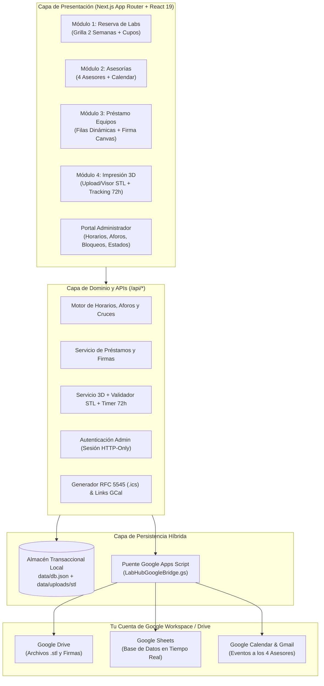

# Arquitectura de Software — LabHub ST (Laboratorios de Ingeniería UPN)

## 1. Revisión Exhaustiva de Requerimientos y Mejoras Arquitectónicas

### 1.1 Análisis Crítico sobre Alojamiento en Google Drive e Integración Google Workspace
> **Pregunta clave del requerimiento:** *"Quisiera que todos los archivos enviados en .stl y los datos puedan guardarse directamente en un google drive. De ser posible todo pueda estar en mi cuenta de google drive, o no sé si haya forma de correr un servidor ahí dónde se albergue todo."*

#### Diagnóstico Técnico:
1. **¿Se puede ejecutar un servidor web en Google Drive?**
   - **Google Drive** es un servicio de almacenamiento de objetos/archivos en la nube, **no un servidor de ejecución de aplicaciones** (Google descontinuó el hosting web estático en Drive en 2016).
   - **Sin embargo, tu cuenta de Google SÍ incluye un motor serverless gratuito acoplado nativamente a tu Drive, Sheets, Calendar y Gmail: Google Apps Script (`script.google.com`).**
   - Si se construyera *toda* la interfaz directamente dentro de Google Apps Script (`HtmlService`), la aplicación sufriría de carga lenta (iframes en caja de arena de Google), mal soporte móvil, límites estrictos en carga de múltiples archivos `.stl` binarios pesados y UX limitada.

#### Solución Arquitectónica Óptima ("Hybrid Cloud + Google Drive Master Storage" — Costo $0):
Diseñamos una arquitectura desacoplada de dos capas que obtiene **lo mejor de ambos mundos**:
1. **Capa de Aplicación Web e Interfaz UX/UI (Next.js 15 App Router + TypeScript + Tailwind CSS):**
   - Desplegable gratis en **Vercel** (o ejecutable localmente / en red interna del laboratorio).
   - Brinda experiencia instantánea, diseño responsivo, lienzo de firma digital HTML5, **visor interactivo 3D de piezas `.stl`** en tiempo real y control de concurrencia.
2. **Motor de Persistencia Dual + Puente Nativo a TU Google Drive (`LabHubGoogleBridge.gs`):**
   - **Persistencia Local Transaccional (`data/db.json` + `data/uploads/stl/`):** Permite que el sistema funcione al 100% desde el primer segundo sin configuración externa, actuando además como caché de alta velocidad y respaldo.
   - **Sincronización Directa con tu Cuenta Personal/Institucional de Google (vía Google Apps Script Webhook incluido en `/google-apps-script/LabHubGoogleBridge.gs`):**
     - **Google Drive:** Crea automáticamente la estructura `LabHub_ST_UPN / Impresiones_3D / <CODIGO_SOLICITUD> /` en **tu propio Google Drive**, almacenando todos los archivos `.stl` originales y subsanados, devolviendo el enlace directo (`driveUrl`). También guarda respaldo de firmas digitales.
     - **Google Sheets (en tu Drive):** Crea y sincroniza automáticamente una hoja de cálculo maestra (`LabHub_ST_BaseDeDatos`) en tu Google Drive con pestañas para `Reservas`, `Asesorias`, `Prestamos_Equipos` e `Impresiones_3D`.
     - **Google Calendar + Gmail:** Al agendarse una asesoría (o reserva), crea automáticamente el evento en **Google Calendar**, invita al correo del asesor correspondiente (`CalendarApp.createEvent` con invitados y alertas) y envía notificación por correo (`MailApp`), además de proveer descarga directa de archivo estándar `.ics` (RFC 5545) y botón *"Añadir a Google Calendar"*.

---

### 1.2 Mejoras y Optimizaciones Incorporadas sobre la Solicitud Original

| Área | Requerimiento Base | Mejora / Optimización Arquitectónica Incorporada |
| :--- | :--- | :--- |
| **1. Reserva de Laboratorios** | 3 Labs (Automatización, Electrónica, Mecatrónica), 9 bloques horarios, vista de hasta 2 semanas, multi-bloque, capacidad simultánea (ej. 4 o 6 grupos). | • **Indicador visual de cupos en vivo** en cada bloque (`3/4 disponibles`, `6/6 libres`, `CLASE`, `BLOQUEADO`).<br>• **Prevención de doble reserva:** impide que el mismo Código UPN reserve dos bloques superpuestos.<br>• Selección multi-bloque fluida con resumen flotante antes de confirmar. |
| **2. Solicitud de Asesorías** | 4 asesores con horario propio y laboratorio asignado; cuenta también como reserva realizada; envía evento a Google Calendar del asesor. | • ** Impacto cruzado transaccional:** al reservar asesoría, se ocupa el turno del asesor **y** se registra automáticamente una reserva vinculada (`origin: 'ASESORIA'`) que descuenta 1 cupo en el laboratorio asignado.<br>• Invitación automática a Google Calendar del asesor + archivo `.ics` descargable. |
| **3. Préstamo de Equipos** | Formulario `ENTREGA DE MATERIALES Y/O EQUIPOS`, filas dinámicas (3 cols equipos, 2 cols integrantes), firma del responsable, ID único, estados `PENDIENTE` y `ENTREGADO`. | • **Pad de Firma Digital suave** (soporte mouse, dedo en móvil y lápiz óptico) exportado en PNG de alta nitidez.<br>• **Vista de Acta Imprimible** para control físico/digital en laboratorio y registro de timestamp exacto cuando el admin marca `ENTREGADO`. |
| **4. Impresión 3D y Plazo de 72h** | Carga múltiple `.stl`, código de seguimiento, 7 estados (`ENVIADO`, `EN REVISION`, `OBSERVADO` con comentario y 72h, `EN COLA`, `IMPRIMIENDO`, `LISTA`, `ENTREGADA`). | • **Analizador y Visor 3D `.stl` integrado:** valida estructura binaria/ASCII real (no solo extensión), calcula dimensiones `X × Y × Z (mm)` y volumen `cm³`, y permite rotar la pieza en 3D.<br>• **Portal de Subsanación 72h:** cuando está `OBSERVADO`, muestra cuenta regresiva en vivo y **permite al alumno subir los `.stl` corregidos dentro de las 72h**, reanudando el flujo a `EN REVISION`. |
| **5. Administración** | 4 asistentes, horarios de asesores y labs, bloqueo de turnos, capacidad por lab, dashboards de asesorías, préstamos e impresión 3D. | • Login por rol para los 4 asistentes + coordinador, asistente interactivo para conectar Google Drive/Calendar en 3 pasos y filtros rápidos por laboratorio/estado. |

---

## 2. Diagrama de Arquitectura del Sistema



---

## 3. Estructura de Directorios y Fronteras de Módulos

```text
labhub-st/
├── ARCHITECTURE.md                       # Diseño arquitectónico y contratos
├── PLAN.md                               # Plan de trabajo y distribución de subagentes
├── google-apps-script/
│   └── LabHubGoogleBridge.gs             # Script listo para desplegar en tu Google Drive
├── src/
│   ├── types/
│   │   └── labhub.ts                     # Contratos de datos inmutables (Single Source of Truth)
│   ├── constants/
│   │   └── schedule.ts                   # Los 9 bloques horarios oficiales, Labs, Carreras, Estados
│   ├── lib/
│   │   ├── api-client.ts                 # Cliente HTTP tipado para Frontend
│   │   ├── stl-parser.ts                 # Parser binario/ASCII .stl (dimensiones, triángulos, validación)
│   │   ├── calendar/ics.ts               # Generador .ics y enlaces Google Calendar
│   │   ├── google/bridge.ts              # Conector asíncrono con Google Drive / Sheets / Calendar
│   │   └── storage/                      # Repositorio transaccional con datos semilla UPN realistas
│   ├── components/
│   │   ├── ui/                           # Sistema de diseño base (botones, modales, alertas, tabs)
│   │   ├── shared/                       # Grilla semanal 2 semanas, Firma Canvas, Visor 3D STL, Navbar
│   │   ├── student/                      # Vistas interactivas de los 4 módulos estudiantiles
│   │   └── admin/                        # Dashboards administrativos, configurador de horarios y Google Sync
│   ├── app/
│   │   ├── page.tsx                      # Portal principal estudiantil
│   │   ├── reservas/page.tsx             # Módulo 1: Reserva de Laboratorios
│   │   ├── asesorias/page.tsx            # Módulo 2: Solicitud de Asesorías
│   │   ├── prestamos/page.tsx            # Módulo 3: Préstamo de Equipos
│   │   ├── impresion-3d/page.tsx         # Módulo 4: Impresión 3D y Seguimiento
│   │   ├── admin/                        # Login y Panel de Administración integral
│   │   └── api/                          # Endpoints RESTful completos
│   └── __tests__/                        # Suite de pruebas unitarias e integración (Vitest)
```

